<h2 align="center">
  
  &nbsp;Student at AGH University of Kraków
  &nbsp;
</h2>

  
  

<picture>
  <source media="(prefers-color-scheme: dark)" srcset="assets/profile-dark.svg">
  
</picture>

<picture>
  <source media="(prefers-color-scheme: dark)" srcset="assets/activity-dark.svg">
  
</picture>

---

### 🧠 Languages

  
  
  
  
  
  
  
  
  
  

### ⚛️ Frameworks & libraries

  
  
  
  
  
  
  
  
  
  
  

### 🗄️ Databases & cloud

  
  
  
  
  
  
  
  
  
  

### 🔧 Tools & infrastructure

  
  
  
  
  
  
  
  
  
  
  

